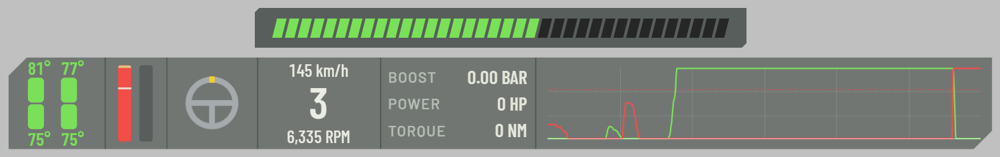

# HUD

The HUD is FDC's in-game telemetry overlay. It renders the normalized Direct
Data Out telemetry that the native layer delivers through `queueTelemetry`; it
has no other data source.

## Overlay window

- The HUD window is transparent, always on top, frameless, and never takes
  focus. It lives on the monitor chosen in **HUD DISPLAY**. Outside a layout
  edit the window shrinks to the rectangle around the visible blocks and
  Delta, and the Shift Bar, with an 8 px margin, so Windows composes less of the screen; blocks
  stay where the layout puts them on the monitor. A layout edit expands the
  window to the whole monitor, and saving or cancelling shrinks it again.
  While no block is visible, for example without live telemetry, the window
  keeps its last size.
- During normal driving the whole window is click-through, so mouse input
  reaches the game.
- Only an active layout edit makes the window accept pointer input; Save,
  Cancel, or Escape restores click-through. Because the window still never
  takes focus, a layout edit started with the edit hotkey leaves Forza in
  focus: the game does not pause, and the keyboard and controllers keep
  driving the car.
- The FDC tray icon offers **Configuration** and **Quit**. The X button of the
  Configuration window also quits FDC, which closes the HUD; minimizing the
  window keeps the HUD running.

## Blocks

The telemetry HUD has six blocks. A separate Delta strip belongs to Events.

| Block | Shows |
| --- | --- |
| Tires | Front and rear tire temperatures in °C with a colored tire shape: blue below 70°, green from 70° to below 82°, yellow from 82° to below 92°, red from 92°. |
| Throttle & Brake | Vertical brake and throttle input meters. With the brake target on, a thin line across the brake meter marks its level; with the peak marker on, a yellow line marks the highest brake level of the latest stop. See [Brake target](#brake-target). |
| Steering | A steering wheel that rotates with steering input, up to 90° at full lock. |
| Gear / Speed / RPM | Speed in the selected unit, the gear (`R`, `N`, or `1`–`10`), and engine RPM. This block also carries the shift cue. |
| Engine / Boost | Boost in bar, power in HP, and torque in N·m. Negative values show as zero, and all three show zero while the throttle is released. |
| Input Graph | The last eight seconds of throttle (green) and brake (red) input. |

**Shift Bar** is an optional block, off by default, above the telemetry HUD. It
shows the Gear block's shift signal as a row of slanted segments that fills with RPM,
which is described under [Shift cue](#shift-cue). It has its own switch in
**WIDGETS** and is positioned, moved, resized, and reset independently, like
Delta. It shows no text.

**Delta** compares the current lap with the active Event reference. It appears
only while recording an Event with a known reference:

- For an Event with a saved Absolute Best trace, Delta is visible immediately.
- For a new Event on a circuit, Delta is hidden during lap 1; from lap 2 onward,
  it shows the best lap so far once that lap completes.
- For a new Event in a sprint, Delta is hidden during the first attempt; from
  the second attempt onward, it shows the best result so far.
- Saved runs recorded before trace storage do not have a trace, so Delta starts
  only after the first new lap (circuit) or attempt (sprint) in that case.

See [Events](events.md#telemetry-recording).

Under the Delta bar, a row of three cells shows FDC's three virtual sectors,
which are equal thirds of the reference lap distance:

- Each completed sector shows its signed time difference from the active Event
  reference, in seconds with three decimals.
- Green means the sector is faster than the reference and yellow means slower.
  Purple means the sector is faster than the best time for that sector across
  the Event's saved results and the current run, regardless of car; purple takes
  priority over green. A sector exactly equal to the reference shows `0.000` in
  a neutral color.
- The sector being driven is shown with a dash and brighter text.
- When a lap finishes, its results stay visible at the start of the next lap
  and are replaced when that lap's first sector completes.
- A sector without a result, such as one whose reference time is unknown, shows
  a dash. A lap that FDC first sees after its start, for example after the
  pause menu, produces no sector results.

### Shift cue

The Gear / Speed / RPM block flashes its background to signal shifts. The
Shift Bar shows the same signal, and the signal is decided once per frame for
both:

- **Flashing red** from 97% of the car's limiter RPM. The limiter is the usable
  RPM ceiling that Shift Light has measured for the car; before that, the
  highest limiter hit so far (from the first hit on); and before any hit, an
  estimate of 89% of the game's maximum RPM, because real limiters sit at
  87–97% of it. Red therefore shows on the first pull too, usually shortly
  before the limiter. Red takes priority over purple. When purple can show,
  the gear's Shift Light target lies above 97% of the limiter, and either the
  limiter has been hit or the target is a shift point Shift Light found for
  this gear (a model point, `POTENTIAL` or `OPTIMAL`), red starts only once RPM reaches that
  target (at most the limiter), so purple shows first. Without that rule, a
  learned point just below an estimated limiter would always be covered by
  red. An unlearned target before any limiter hit is the game's maximum RPM,
  so red does not wait for it. There is no red below 97%, and red never stays
  steady.
- **Flashing purple** at the Shift Light cue, the RPM where Shift Light turns on
  for the current gear, when the **FDC Shift Light** option is enabled. There
  is no purple in the last known gear, the gear the car has never been upshifted
  from. The approach phase of Shift Light shows nothing.

With **FDC Shift Light** off, only the red limiter flash appears. Both colors
alternate every 440 ms between the full color and a dimmer tone, and the Gear
block and the Shift Bar use the same timing, so they flash together. Red follows
the REDLINE brightness and purple follows the FDC SHIFT LIGHT brightness in the
SHIFT CUE card on the Shift Light tab. The Gear block's red text is unchanged.
How targets are learned is described in [Shift Light](shift-light.md).

The **Shift Bar** widget shows the same signal as a row of 36 identical,
right-leaning parallelogram segments, none rotated. The segments are evenly
spaced: each one starts a whole number of screen pixels after the previous one,
so every gap is the same width at any size and display scaling. Its green fill
rises from idle RPM to the signal point: the Shift Light cue RPM when purple can
show, which falls back to Shift Light's target RPM if the cue RPM is missing,
and otherwise the point where red starts; the bar is never filled later than
red starts. Filled segments are whole, so the bar is full only at the signal
point. While red or purple is showing, every segment lights in that color and
flashes in step with the Gear block. The bar shows no text.

### Brake target

The brake target is an optional reference line for braking. Its options sit
directly under the **Throttle & Brake** row in the **WIDGETS** card of
Configuration → **HUD**, indented as part of that row under the heading
**BRAKE TARGET**. Both of its switches are off by default:

- **TARGET** (switch and slider): one target mark at the chosen level, from 5%
  to 100% in 5% steps, default 70%. It is a thin line across the brake bar of
  the Throttle & Brake block and a dashed line at the same level on the Input
  Graph.
- **PEAK MARKER** (switch): a yellow line on the brake bar showing the highest
  brake level of the latest stop. It is a plain level: it is not compared with
  the target and is not colored as good or bad. It is shown only on the brake
  bar.

The options stay visible and turn disabled, with a short hint, while the widget
they need is off:

- TARGET (switch and slider) is disabled when both Throttle & Brake and Input
  Graph are off, with the hint "Turn on Throttle & Brake or Input Graph to see
  the target.". The slider is also disabled while TARGET is off, with the hint
  "Turn on TARGET to choose the level.";
- PEAK MARKER is disabled while Throttle & Brake is off, with the hint "Turn on
  Throttle & Brake to see the peak marker.".

Disabling never changes the stored target, level, or peak setting; they come
back when the widget is turned on.

A stop is a period in which the brake pedal is at 5% or more. A dip below 5%
shorter than 0.3 s belongs to the same stop. A stop counts once it has lasted
0.2 s:

- until then, the previous peak stays;
- after that, the marker follows the highest level of the new stop as it rises;
- a stop shorter than 0.2 s leaves the previous peak in place.

The peak is cleared in the pause menu and other non-driving screens (when
racing is not on), and when the car changes. Changes in Configuration apply at
once and are saved locally, like HUD OPACITY.

## Visibility

- With **Show HUD with telemetry** enabled (the default; its switch is in the
  DISPLAY card of Configuration → **HUD**), the HUD, Delta, and
  the Shift Bar are visible only while Forza reports live driving; Delta
  additionally needs an active Event reference. Forza keeps sending Data Out
  in the pause menu, garage, and other menus but reports that racing is not
  on, so the HUD hides there. A 500 ms hold keeps a single non-live packet from
  making it blink.
- With the option disabled, the HUD stays visible without live telemetry.
- The Shift Bar is off until its switch is turned on, after an update too. It
  keeps showing with the Gear / Speed / RPM block switched off.
- In Configuration, each widget in the **WIDGETS** list has its own switch,
  and **ALL** turns every widget, Delta and the Shift Bar included, on or off at
  once. When
  every block is hidden, the telemetry HUD is not shown. Versions before
  7.28 had one switch for the whole telemetry HUD; if it was off, FDC turns
  every block off on its first start after the update, so the HUD stays
  hidden.

## Layout

Configuration → **HUD** has three cards, in this order, the same in both
arrangements:

- **DISPLAY**: HUD DISPLAY, HUD OPACITY, and **SHOW HUD WITH TELEMETRY**, each
  described under [HUD display](#hud-display), [HUD opacity](#hud-opacity), and
  [Visibility](#visibility).
- **LAYOUT**: one raised plate with three rows, in this order:
  1. **ARRANGEMENT**, a segmented choice of GROUPED (default) and FREEFORM; the
     selected one keeps a lime fill. Grouped keeps the visible blocks side by
     side in one panel and moves and resizes that panel as a whole. Freeform
     places and sizes every block independently. Delta and the Shift Bar are
     positioned independently in both arrangements and keep one saved position
     for both; the HUD blocks keep a saved position for each arrangement.
  2. **EDIT THE LAYOUT**: a title and a sentence on the left and its controls on
     the right. It has **RESET LAYOUT** and **EDIT LAYOUT** (the lime next
     step); while an edit runs it shows **EDITING** in yellow with **CANCEL**
     and **SAVE**.
  3. **IN-GAME EDIT HOTKEY**: the hotkey and **CHANGE**, like GLOBAL RECORD
     HOTKEY.
- **WIDGETS**: one compact row per widget with its name and a switch (Tires,
  Throttle & Brake, Steering, Gear / Speed / RPM, Engine / Boost, Input Graph,
  Delta, Shift Bar), and **ALL** in the card header. Clicking anywhere on a row
  toggles its widget. The Shift Bar row starts off. **ALL** is on only while
  every widget is on, the Shift Bar included. Under the Throttle & Brake row,
  the **BRAKE TARGET** options are indented as part of that row; they are
  described under [Brake target](#brake-target).

Below 680 px of window width, each row of the LAYOUT plate stacks its controls
under its text, and the arrangement choice moves under its description.

A layout edit covers every enabled target at once: in Grouped, the HUD panel,
Delta, and the Shift Bar; in Freeform, each block whose switch is on, Delta, and
the Shift Bar. A switched-off
widget stays out of the edit; switch it on to place it. Two ways start it:

- **EDIT LAYOUT**. While the edit runs, **SAVE** and **CANCEL** take its place
  in Configuration, and **RESET LAYOUT** is hidden. With every widget off,
  Configuration asks to turn one on instead;
- the edit hotkey, `Ctrl + Shift + F8` by default, pressed while Forza is in
  focus. Pressing it again saves the edit. With every widget off, the hotkey
  does nothing.

**RESET LAYOUT** asks for confirmation and then returns every block, Delta, and
the Shift Bar to its default place and size in both arrangements.

By default the Shift Bar sits directly above the telemetry HUD, centered on it
with a 10 px gap. Its default size is 0.5× the Grouped HUD: at 1× HUD scale it is
368 px wide and 30 px high. The default is also its smallest size, so the Shift
Bar can only be made larger, up to 2×; a never-resized bar and RESET LAYOUT both
return it to 0.5×. Delta sits 10 px above the Shift Bar while the bar is on, and
10 px above the HUD while it is off. A saved position always wins over these
defaults, and a Delta or Shift Bar place that is not saved follows the HUD and
the Shift Bar switch.

During the edit:

- every target in the edit stays visible, even when **Show HUD with
  telemetry** would otherwise hide it, and Delta shows without an Event;
- clicking or dragging a target on the screen selects it; the selected target
  shows the edit toolbar with `DRAG <TARGET> TO MOVE · CORNER TO RESIZE ·
  CLICK A BLOCK TO SELECT` and its corner handles;
- drag any target to move it; with the grid on, it moves along the
  alignment grid described below;
- drag a corner of the selected target to resize it between 0.5× and 2× of
  its base size, where the default is 1× for every block except the Shift Bar;
  the Shift Bar starts at its 0.5× default and can only be made larger, up to
  2×; resizing never snaps;
- **GRID ON**, filled with lime, on every edit toolbar turns the grid and
  snapping off and then reads **GRID OFF** with a plain frame; pressing it
  again turns them back on. It is on by default, and FDC remembers the choice;
- **SAVE** (filled with lime at rest) keeps every change; **CANCEL** (neutral
  dark, fills lime on hover) or Escape restores every target to its position
  at the start of the edit; **RESET** (caution text and border, fills caution
  on hover) returns the selected target to its default placement until the
  edit is saved or cancelled, and sits apart with extra space.

While Forza has focus, Escape reaches the game and opens its pause menu, so
use **CANCEL** to discard an edit started with the hotkey.

### Alignment grid

With **GRID** on, the edit shows an alignment grid under the HUD, and it
disappears when the edit ends:

- thin major lines divide the monitor into 4 × 4 equal zones, so the screen
  center and the edges are major lines;
- dots mark a square minor grid whose step is the screen height divided by 36,
  about 30 px at 1080p, 40 px at 1440p, and 60 px at 4K. It is measured from
  the screen center outward, so the center lines are on it; on 16:9 screens
  the major lines fall on the minor grid.

While a target is dragged, its top-left corner jumps from dot to dot: the
target's real edges, not the dashed edit frame drawn 5 px outside it, sit on
the nearest dots. When the target's center comes within half a grid step of a
major line inside the screen (25%, 50%, or 75%), the target centers on that
line instead, so it can sit exactly in the middle of the screen. Pushed
against a screen edge, a target stays flush with it. The saved position is
still relative to the screen size, so after a resolution change a target keeps
its place but may sit a few pixels off the new grid.

The edit hotkey is chosen like the Driver Analysis record hotkey: **CHANGE**,
then a key combination with Ctrl, Alt, or Shift, or a controller button. Esc
keeps the current hotkey. Windows-key combinations are not allowed, and the
edit hotkey cannot be the same as the Driver Analysis hotkey. The choice is
stored in the local application webview storage.

By default the telemetry HUD sits centered near the bottom of the screen with
Delta directly above it. Positions are stored relative to the screen size, so
they survive a resolution change. Switching modes keeps each mode's own saved
positions.

## HUD display

**HUD DISPLAY** on the HUD tab lists every connected monitor by its Windows
display number and resolution, and marks the primary monitor. Choosing one
moves the HUD to that monitor immediately, and FDC remembers the choice.
Until a monitor is chosen, the HUD uses the primary monitor. If the saved
monitor is not connected at startup, the HUD uses the primary monitor and the
card says so. The list is unavailable while a layout edit is active.

When Windows moves the HUD to another monitor, for example with
Win+Shift+Arrow, FDC places it on that monitor, shrinks it again around the
visible blocks, and remembers the monitor as the choice.

## HUD opacity

**HUD Opacity** sets the opacity of the whole overlay, including Delta and the
Shift Bar, from 1%
to 100%. The default is 80%, and **RESET** restores it.

## Display settings

Configuration → **Settings** opens with a short intro that also notes all FDC
data stays on this PC. Its rows span the content width, aligned with the
navigation, grouped under **WINDOW & EXIT** (the first three below, of which
**Theme** is hidden for now), **PERFORMANCE** (the next one), and **UNITS** (the
last two). **Show HUD with telemetry** is in the DISPLAY card of the HUD tab,
described under [Visibility](#visibility):

- **Configuration always on top**, off by default;
- **Confirm before quitting**, on by default: the Configuration X button asks
  **QUIT FDC?** first. From the second confirmed quit the question offers
  **Don't ask again**, which turns this off. A Driver Analysis or Event
  recording in progress always asks;
- **Theme**: not shown for now. Theme selection is switched off
  (`THEME_SELECTION_ENABLED` in `overlay/display-preferences.js`), so the
  Configuration window is always dark, including its title bar, whatever was
  saved. A previously saved `LIGHT` or `SYSTEM` choice is kept and applies again
  when selection is switched on;
- **HUD rendering**: `GPU`, the default, or `CPU`. With `CPU` the HUD and
  Configuration are drawn on the processor and composited by Windows, so the
  HUD keeps up with the game when Forza fully loads the graphics card, at the
  cost of some game FPS. The choice is saved in `hud-rendering.json` in the FDC
  application-data directory and applies from the next FDC start; until then
  the row says which renderer is still in use;
- **Speed unit**: `km/h` or `mph` for speeds in the HUD, Events, and Driver
  Analysis;
- **Distance unit**: `km` or `mi` for distances in Events and Driver Analysis.
  Short distances, such as the Events map hover, use `m` or `ft`. A preference
  record without a distance unit defaults to `mi` when the speed unit is `mph`.

Units are display-only: telemetry, `fdc.sqlite`, and saved traces stay in
km/h and meters, and changing a unit immediately redraws the open views.

## Persistence

HUD layout, block and overlay visibility, opacity, the brake target and peak
marker settings, the HUD edit hotkey, the GRID choice, speed and distance units,
and brightness preferences are stored
in the local application webview storage. They are not written to
`fdc.sqlite`. The **HUD DISPLAY** monitor is stored in
`hud-display.json` in the FDC application-data directory, because FDC places the
HUD before the page loads.

## Browser demo

`index.html?demo=1` renders the HUD with synthetic telemetry for offline visual
checks; see [Development](development.md#browser-demo).
